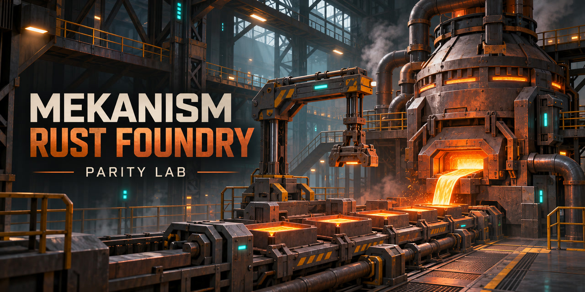

# Mekanism Rust Foundry



Mekanism Rust Foundry is the independent, community-led home for a future native Rust port of Mekanism for Horizon. The current **Parity Lab** phase records and validates behavioral references from the pinned original Java JAR. Gameplay implementation starts only after the applicable scope passes pre-port qualification.

The lab already exercises dedicated servers, hidden real-client fixtures, comparator and observer faults, chunk controls, and trace seals. The Enrichment Chamber is the bounded machine pilot. Runtime registry discovery is a separate evidence layer. [Status](STATUS.md) · [Roadmap](docs/planning/README.md) · [MIT license](LICENSE)

[Start here](https://github.com/GabrielNichols/mekanism-rust-foundry/issues/8) · [GitHub roadmap](docs/planning/GITHUB-ROADMAP.md) · [Work packages](docs/planning/FOUNDRY-WORK-PACKAGES.md) · [Wiki](https://github.com/GabrielNichols/mekanism-rust-foundry/wiki) · [Discussions](https://github.com/GabrielNichols/mekanism-rust-foundry/discussions) · [Preview releases](docs/releases/README.md)

This is an independent community project. Not an official Minecraft product. Not approved by or associated with Mojang or Microsoft.

## Start with one small task

1. Pick an open-sized slice from the [first-wave workstreams](docs/planning/FIRST-WAVE-WORKSTREAMS.md). A good first PR reconciles one Core registry and recipe key in the [inventory crosswalk](docs/planning/FIRST-WAVE-INVENTORY.md). [Starter issue #1](https://github.com/GabrielNichols/mekanism-rust-foundry/issues/1) · [First-wave umbrella #7](https://github.com/GabrielNichols/mekanism-rust-foundry/issues/7)
2. Run the dedicated smoke case below to learn the evidence path.
3. Follow the [contribution guide](CONTRIBUTING.md#task-to-pull-request). Attach sanitized evidence and use the [PR template](.github/PULL_REQUEST_TEMPLATE.md).

## Quickstart on Windows x64

Use PowerShell 7, Rust 1.95.0, and a local JDK 21. Review the Minecraft EULA before running the reference. The setup script resolves pinned Minecraft 1.21.1, NeoForge 21.1.200 and Mekanism Core 10.7.19.85 into private local storage. [Minecraft EULA](https://www.minecraft.net/en-us/eula)

```powershell
git clone https://github.com/GabrielNichols/mekanism-rust-foundry.git
Set-Location mekanism-rust-foundry
cargo build --locked
./adapters/neoforge/prepare-reference.ps1 -Jdk '<JDK21-directory>'
./target/debug/mek-lab.exe run-reference .lab/environment.json cases/server-inventory.json .lab/evidence/first-run
./target/debug/mek-lab.exe verify-reference .lab/evidence/first-run
```

Choose a new output directory for every attempt. The dedicated smoke case verifies the barrel count, tick advancement and trace seal. A valid seal ties the exact trace to its attempt. It does not qualify a Mekanism family. A successful result reports `functional_pass` in `.lab/evidence/first-run/result.json`. The verifier prints four frames, byte count and SHA-256. Report the case ID, verdict and seal digest. [Clean-checkout verification](evidence/contributor-quickstart.json) Keep the raw world and logs private. [Evidence contract](VALIDATOR-CONTRACT.md#reference-trace-seals)

## Current implementation

The dedicated `run-catalog` bootstrap compares one serial 20 ticks/s run with three fresh 100 ticks/s workers. It exports selected registry, recipe and config identities. Treat the result as diagnostic discovery until the effective reference and behavior scope are reviewed. [Core catalog evidence](evidence/core-catalog-bootstrap.json)

- SHA-256 artifact verification, runner and scenario identity, effective configuration fingerprints, and a new output directory for every attempt.
- Typed traces with exact decimal i64 values, bitwise f64 values and structured state; first-difference comparison and rejection of empty or incomplete captures.
- Process supervision with structured arguments, logs, deadlines, private directories and Windows Job Objects.
- A NeoForge development bridge that queries state on the authoritative thread and advances a frozen server by bounded tick budgets.
- A real Java client: keybinding placement, Screen-handler inventory actions, processing and output pickup, checked on both server and client.
- Validated per-tick capture, independently decoded region-file NBT, and comparison of detailed versus terminal capture. [VALIDATOR-CONTRACT.md](VALIDATOR-CONTRACT.md) defines the scope and limits.
- Inventory reconciliation between public capability slots, scenario aliases and typed NBT, with rejected payloads retained for diagnosis.
- Actual JVM tick/batch measurements, including CPU, GC, sampled heap and snapshot construction cost, kept separate from the semantic trace.
- An offline Rust work ledger that separates real recipe production from administrative fixture items.

`cases/server-inventory.json` is a component fixture on a real server. `cases/client-placement-menu.json` places an Enrichment Chamber, opens its menu and moves three ores through real cursor and slot handling. `cases/client-processing-menu.json` extends that flow through processing and output pickup. Terrain, player pose and starting items are declared administrative setup. Client ingress is through keybindings and Screen handlers; it does not qualify operating-system mouse or keyboard input.

The server pilot in `cases/enrichment-lifecycle.json` exercises normal processing, absent and insufficient energy, full output, extraction and resumption. Energy is supplied through the public FE API. Filling the output stack is an explicit administrative fixture; it does not qualify a generator, cable or player-driven blocked-output setup.

## Run on Windows x64

The exercised environment uses Rust 1.95.0, PowerShell 7.6.5, JDK 21.0.13, Minecraft 1.21.1, NeoForge 21.1.200 and Mekanism 10.7.19.85. Preparation and campaign scripts require PowerShell 7. The mod's internal metadata reports 10.7.19; build 85 is identified by the jar bytes. Other platforms and the declared MSRV need separate qualification.

```powershell
cargo test --locked
cargo clippy --locked --all-targets -- -D warnings
cargo build --locked
./adapters/neoforge/prepare-reference.ps1 -Jdk '<JDK21-directory>'
./target/debug/mek-lab.exe run-reference .lab/environment.json cases/server-inventory.json "$PWD/.lab/evidence/server-001"
./target/debug/mek-lab.exe run-reference .lab/environment.json cases/client-processing-menu.json "$PWD/.lab/evidence/client-001"
./adapters/neoforge/test-reference.ps1 -OutputRoot "$PWD/.lab/evidence/campaign-001"
./adapters/neoforge/test-processing.ps1 -OutputRoot "$PWD/.lab/evidence/processing-campaign-001"
```

Every output destination must be new. The real-client profiles require a GLFW context created hidden and verify its visibility throughout rendering. The NeoForge loader splash is disabled, and the runner shuts down its processes. Preparation uses PowerShell to install dependencies, while the running validation engine is Rust and requires no Python. The resource profile provides the minimum English/font/icon assets with sound disabled; audio is not qualified. Jars, resources and saves stay in ignored `.lab/`, outside the public source tree.

Review and regenerate the lock after changing the binary, bridge or dependencies. This does not update expected results. Preparation checks the installer and Mekanism jar against fixed hashes and library/resource downloads against official metadata. It does not replace the personal launcher or reuse player worlds.

```powershell
./target/debug/mek-lab.exe verify-reference .lab/evidence/server-001
./target/debug/mek-lab.exe compare .lab/evidence/server-001/trace.json .lab/evidence/server-002/trace.json
./target/debug/mek-lab.exe compare-observer <every-tick-run-directory> <terminal-run-directory>
./target/debug/mek-work.exe <run-directory>
./target/debug/mek-lab.exe benchmark-summary <paired-study.json>
```

The baseline campaign creates three fresh servers, compares their A/A traces and runs a real client. The processing campaign creates three fresh pairs with alternating capture-mode launch order, checks same-mode A/A repetition, reconciles saved NBT and work accounting, and runs the processing client scenario. Neither script skips failed cases or retries mutations. Both use the already prepared binary and lock.

`benchmark-summary` summarizes supplied measurements; it does not collect them or establish their provenance. A functional pass still leaves `qualified=false`, `port_equivalence_proven=false` and `optimization_proven=false`: the broad roadmap gates remain open.

## Bridge-free and recovery controls

Run the lifecycle suite after preparing the pinned Windows x64 reference. Each repeat starts fresh server processes in a new output directory and uses a copy of the same saved seed for every treatment.

```powershell
./target/debug/mek-lab.exe run-lifecycle .lab/environment.json .lab/evidence/recovery-new 3
```

The suite exercises continuous processing with the bridge absent and with every-tick bridge observation, graceful restart, and forced termination before and after an acknowledged save flush. In bridge-free processes, the Rust runner uses the local server console and reads region NBT after exit. Keep the run directory private. It contains logs, environment paths, and worlds.

The [lifecycle campaign](evidence/lifecycle-campaign.json) records 15 passes across three cohorts, including the saved-state witnesses and separate timing intervals.

## Observer controls and faster test runs

```powershell
./target/debug/mek-lab.exe simulate-observer .lab/evidence/simulated-observer-new
./target/debug/mek-lab.exe run-live-observer-audit .lab/environment.json .lab/evidence/live-observer-audit-new
./target/debug/mek-lab.exe run-observer-controls .lab/environment.json .lab/evidence/observer-baseline-new 1 20 1
./target/debug/mek-lab.exe run-observer-controls .lab/environment.json .lab/evidence/observer-fast-new 3 100 3
```

The live command accepts repeat count, target ticks per second, and worker count in that order. Supported ranges are 1–3 repeats, 20–100 ticks per second, and 1–4 workers. Each repeat compares the bridge absent, installed but disabled, and enabled with every-tick observation. Workers run independent server instances, each with its own world, configuration, logs and loopback port. Each JVM preserves its owner-thread tick order. Use the serial 20 ticks/s profile as the reference and compare all checkpoints before using a faster profile for regression feedback. [Minecraft tick command reference](https://feedback.minecraft.net/hc/en-us/articles/21968446892173-Minecraft-Java-Edition-1-20-3)

The [live observer campaign](evidence/observer-controls-campaign.json) records the serial and parallel profiles. The [simulated fault campaign](evidence/simulated-observer-faults.json) contains the injected replies, independent witnesses and rejection timings.

The [live fault audit](evidence/live-observer-audit.json) exercises stale capture and a real inventory change after a bridge read. The [trace seal controls](evidence/trace-seal-controls.json) demonstrate why a structurally valid trace still requires a matching attempt result and hash.

## Client phases and chunk observation

```powershell
./target/debug/mek-lab.exe run-reference .lab/environment.json cases/client-causal-barrier.json .lab/evidence/client-causal-new
./target/debug/mek-lab.exe verify-reference .lab/evidence/client-causal-new
./target/debug/mek-lab.exe run-chunk-controls .lab/environment.json .lab/evidence/chunk-controls-new
```

The client case uses a real Screen pickup, witnesses the change on the server, waits for a fresh authoritative menu revision, and captures after the client renders that revision. A capture request before the barrier must produce no image. The client uses a hidden Windows GLFW/OpenGL context. The dedicated chunk campaign runs three pairs at 100 ticks/s with two workers, with a three-tick observation window and a check of the target region slot after shutdown.

The [phase and chunk campaign](evidence/phase-chunk-controls.json) contains three sealed real-client trials and six dedicated chunk trials. All three early capture requests were blocked after local prediction and before an authoritative menu revision.

## Evidence and contribution

[STATUS.md](STATUS.md) records the exercised scope, evidence and remaining gates. [CONTRIBUTING.md](CONTRIBUTING.md) explains setup, meaningful TDD, evidence handling and review expectations. Recorded RED/GREEN cycles are indexed in [evidence/tdd](evidence/tdd). Compilation, access, preparation and boot errors remain separate from semantic failures.

The [final processing campaign summary](evidence/processing-campaign.json) records seven fresh functional passes, three observer comparisons and four same-mode A/A comparisons. [Offline comparator controls](evidence/comparator-controls.json) preserve an unchanged roundtrip and reject known transient and missing-frame differences in an actual Java trace. These processing checks use the Java bridge. The lifecycle suite independently exercises bridge absence, and candidate qualification remains a separate gate.

The repository-local [planning bundle](docs/planning/README.md) is the canonical requirements baseline for contributors. Its [roadmap](docs/planning/ROADMAP.md) retains the original IDs and coverage criteria. Implementing infrastructure or a pilot does not automatically qualify its 117 behavior families. Remaining work includes broader in-game observer and transport faults, complete phase and causal barriers, broader typed protocol support, generation and shrinking, multiple clients, wider recovery, statistical controls, audio, and the Horizon adapter. Workspace reports remain historical entry points.

The NBT codec's supported formats and limits are explicit in the validator contract. Transport authentication and the interval between process spawn and Job Object assignment still need the roadmap's adversarial controls.

Java temporary directories are private and short on Windows to respect local socket path limits. See the [JDK 21 networking properties](https://docs.oracle.com/en/java/javase/21/docs/api/java.base/java/net/doc-files/net-properties.html).
